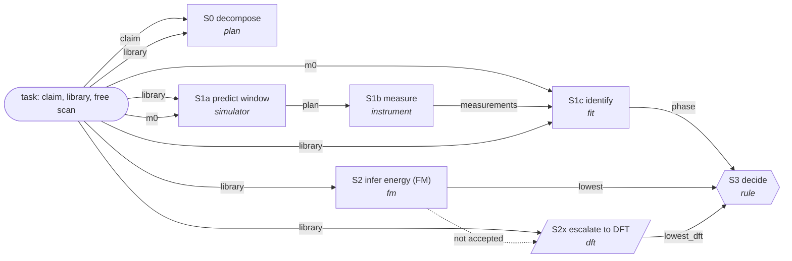

# Exemplar graph: R relative stability (graph_R.json)

Claim: "The crystalline phase in this sample is the lowest-energy polymorph of ScPPd2." S1 (identify the sample by measurement) and S2 (rank the polymorphs by the FM) are independent; S3 joins them. S2x buys DFT only when the FM margin falls inside the band.

| node | module | one line |
|---|---|---|
| S0 decompose | plan | Split the claim into the subgoals it needs: which polymorph the sample holds, and which polymorph of the composition lies lowest in energy. |
| S1a predict window | simulator | Simulate every library polymorph and find the cheapest measurement plan whose expected separation reaches D_accept against every other polymorph. |
| S1b measure | instrument | Acquire the measurements of the plan. |
| S1c identify | fit | Fit every library polymorph to all measurements, the free scan included, with nuisances free, and report the favoured polymorph and its separation D from the best other polymorph. |
| S2 infer energy (FM) | fm | Predict the formation energy per atom of every library polymorph with the FM, and report the lowest polymorph and the margin to the next. |
| S2x escalate to DFT | dft | When the FM margin falls inside the reliability band, buy exact DFT energies for every library polymorph. |
| S3 decide | rule | SUPPORTED if the identified polymorph is the lowest, REFUTED if another polymorph is lower, CANNOT_TELL if identification is not decisive or no reliable ranking exists. |

Constants: D_accept 25, D_undecisive 9, band 0.045, exemplar_margin_factor 2, budget_min 180, dft_price_min 60.
